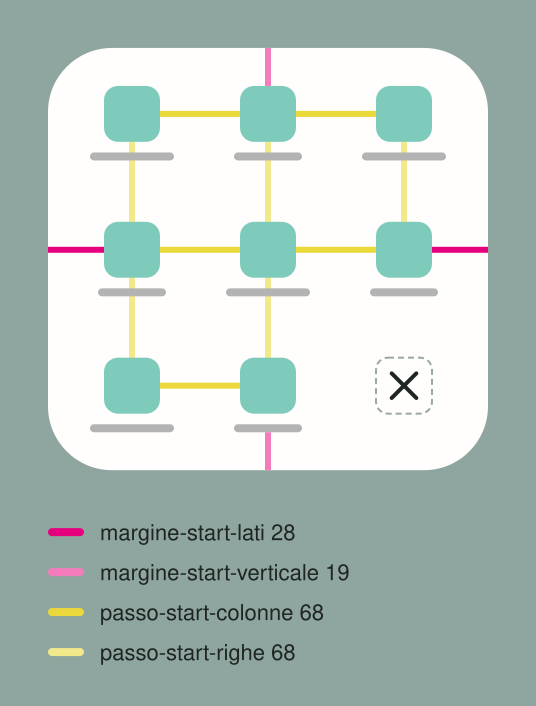

# MenuStart

The menu that grows out of the Tondo, close to the thumb's side, with the × in place of the Tondo. (The Italian sheet is `README.md`, and it wins if the two disagree.)

- **Two shapes**: **9 keys**, three columns by three rows; **8 keys**, four rows of two, with the
  same pitches and margins. The panel is anchored at the bottom and grows upward. Up to four cells it
  is a 2 x 2, and three cells form a single row.
- **Sizes**: keys `cella-start-altezza` (64) tall, panel corners `raggio-start` (32); the panel
  grows from its corner in 110 ms. The spacing is below.

## 🚧 The rule that comes first

**The panel never enters the gesture bar or its fade.** It holds for every panel that opens from
the bottom, and it comes before every ideal value: if a value would bring the bottom of the panel
into the bar or the fade, the value gives way.

## 📐 Spacing

| | rule | token | value |
|---|---|---|---|
| 🟥 | **Side margin**, the same on the left and right, from the edge to the icon | `margine-start-lati` | 28 |
| 🩷 | **Top margin**, measured on the ink: from the edge to the icons of the first row | `margine-start-alto` | 22.7 |
| 🟪 | **Bottom margin**, measured on the ink: from the labels of the last row, the lowest piece, to the edge | `margine-start-basso` | 19 |
| 🟨 | **Horizontal pitch**: the distance between the centers of two neighboring icons, equal across all columns | `passo-start-colonne` | 68 |
| 🟨 | **Vertical pitch**: the same distance between two rows, equal across all rows; ideally it matches the horizontal one | `passo-start-righe` | 68 |
| ✖️ | **The × is centered on the center of the Tondo** it replaces. The rule 'on the center of an icon's place' holds only when the two centers coincide, as in mockups | `icona-start` | 28 |
| 🏷️ | **The label** is centered under the icon, 3 below it, on a 12-tall line, at most 56 wide; its ink ends 9.3 below the icon | `etichetta-start-spazio`, `etichetta-start-riga`, `etichetta-start-max`, `etichetta-start-inchiostro` | 3, 12, 56, 9.3 |

- **The panel size follows from the tokens** and isn't written separately: width = 2 side margins +
  (columns - 1) pitches + icon; height = top margin + bottom margin + (rows - 1) vertical pitches +
  icon + label ink. The 9-key menu is 220 x 215, the 8-key one 152 x 283, a 2 x 2 152 x 147.
- **`build/build.py` draws the diagram from the tokens**, like the page: it isn't edited by hand.

### ✏️ Ideal values, and when they adapt

These sizes are the **ideal values**: early proposals and mockups use them. A real menu can depart
from them, always within the gesture bar rule, mainly in three ways:

| | when | how | example |
|---|---|---|---|
| ⬜ | the menu is **almost square** | make it fully square | 9-key menu: 220 x 220 instead of 220 x 215 |
| ↔️ | a **long label** needs room | widen the side margin, equally on both sides | 8-key menu: 166 x 283 instead of 152 x 283 |
| 👍 | the menu is meant for **one-handed use** | tighten the spacing, mostly vertically | 8-key menu: 152 x 260 instead of 152 x 283 |

- **The owner decides exceptions to spacing and centering**: whoever designs a menu starts from the
  ideal values and proposes the departure, rather than applying it on their own.

## 🧭 Behavior

- **Order**: rows fill from the bottom, so the first item sits next to the ×, in the most
  comfortable spot; a gap goes in the top row, far from the thumb. For left-handed users every row
  is mirrored. The longest label doesn't take the rounded corner at the bottom.
- **It closes after every tap**, with a tap on the scrim and with Back, which pulls it back toward
  its corner following the finger.
- **In Aomidori for Android** it is the 8-cell `Start`: book and Markdown with
  `Indice` (Contents) next to the ×, comic with `Vai a tavola` (Go to page). **In AIV** the home screen
  has the 9-key shape in the GitHub variant and the 8-key shape in AIV Play; a folder has at most
  four cells.
- The consumer provides the items (icon, short label, action) in right-handed reading order.
