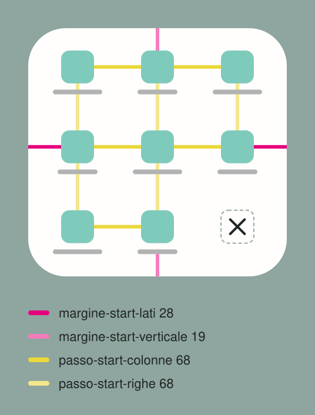

# MenuStart

Il menu che cresce dal Tondo, vicino al lato del pollice, con la × al posto del Tondo.

- **Due forme**: **da 9**, tre colonne per tre righe; **da 8**, quattro file da due, con gli
  stessi passi e gli stessi margini. Il pannello è ancorato in basso e cresce verso l'alto. Fino a
  quattro celle è un 2 x 2, e tre celle formano una riga sola.
- **Misure**: tasti alti `cella-start-altezza` (64), angoli del pannello `raggio-start` (32); il
  pannello cresce dal suo angolo in 110 ms. Le distanze sono qui sotto.

## 🚧 La norma che viene prima

**Il pannello non entra mai nella barra dei gesti né nella sua sfumatura.** Vale per ogni pannello
che si apre dal basso, e viene prima di ogni valore ideale: se un valore porterebbe il fondo del
pannello nella barra o nella sfumatura, il valore cede.

## 📐 Distanze

| | regola | token | valore |
|---|---|---|---|
| 🟥 | **Margine laterale**, uguale a sinistra e a destra, dal bordo all'icona | `margine-start-lati` | 28 |
| 🩷 | **Margine in alto**, misurato sull'inchiostro: dal bordo alle icone della prima fila | `margine-start-alto` | 22,7 |
| 🟪 | **Margine in basso**, misurato sull'inchiostro: dalle etichette dell'ultima fila, il pezzo più in basso, al bordo | `margine-start-basso` | 19 |
| 🟨 | **Passo orizzontale**: la distanza fra i centri di due icone vicine, uguale fra tutte le colonne | `passo-start-colonne` | 68 |
| 🟨 | **Passo verticale**: la stessa distanza fra due righe, uguale fra tutte le righe; l'ideale è che sia uguale a quello orizzontale | `passo-start-righe` | 68 |
| ✖️ | **La × si centra sul centro del Tondo** che sostituisce. La regola 'sul centro del posto di un'icona' vale solo quando i due centri coincidono, come nei mockup | `icona-start` | 28 |
| 🏷️ | **L'etichetta** è centrata sotto l'icona, a 3 da lei, su una riga alta 12, larga al massimo 56; il suo inchiostro finisce 9,3 sotto l'icona | `etichetta-start-spazio`, `etichetta-start-riga`, `etichetta-start-max`, `etichetta-start-inchiostro` | 3, 12, 56, 9,3 |

- **Le dimensioni del pannello si ricavano dai token**, e non si scrivono a parte: larghezza = 2
  margini laterali + (colonne - 1) passi + icona; altezza = margine in alto + margine in basso +
  (righe - 1) passi verticali + icona + inchiostro dell'etichetta. Il menu da 9 misura 220 x 215,
  quello da 8 152 x 283, un 2 x 2 152 x 147.
- **Lo schema lo genera `build/build.py` dai token**, come la pagina: non si modifica a mano.

### ✏️ Valori ideali, e quando si adattano

Queste misure sono i **valori ideali**: le proposte preliminari e i mockup si fanno con loro. Un menu
vero può scostarsene, sempre dentro la norma della barra dei gesti, soprattutto in tre modi:

| | quando | come | esempio |
|---|---|---|---|
| ⬜ | il menu è **quasi quadrato** | lo si rende quadrato del tutto | menu da 9: 220 x 220 al posto di 220 x 215 |
| ↔️ | un'**etichetta lunga** chiede spazio | si allarga il margine laterale, uguale sui due lati | menu da 8: 166 x 283 al posto di 152 x 283 |
| 👍 | il menu è pensato per l'**uso a una mano** | si stringono le spaziature, soprattutto in verticale | menu da 8: 152 x 260 al posto di 152 x 283 |

- **Le eccezioni a spaziature e centrature le decide il titolare**: chi disegna un menu parte dai
  valori ideali e propone lo scostamento, non lo applica da sé.

## 🧭 Comportamento

- **Ordine**: le file si riempiono dal basso, quindi la prima voce è accanto alla ×, nel punto più
  comodo; un vuoto va nella fila in alto, lontano dal pollice. Per i mancini ogni fila è
  specchiata. L'etichetta più lunga non prende l'angolo arrotondato in basso.
- **Si chiude dopo ogni tocco**, col tocco sul velo e con l'Indietro, che lo fa rientrare verso il
  suo angolo seguendo il dito.
- **In Aomidori per Android** è lo `Start` da 8 celle: libro e Markdown con `Indice`
  accanto alla ×, fumetto con `Vai a tavola`. **In AIV** la casa ha la forma da 9 nella variante
  GitHub e quella da 8 in AIV Play; una cartella ha al massimo quattro celle.
- Il consumatore fornisce le voci (icona, etichetta breve, azione) nell'ordine di lettura dei
  destri.
